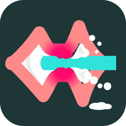

# SECS 2R



SECS 2R은 룸 보정 설계 프로그램 [SECS 2](https://github.com/Kim-O-O/Sound-Equalization-and-Correction-System-2)를 러스트 코어와 Tauri 화면으로 다시 만드는 포크입니다. 스피커 응답을 측정하거나 REW 측정을 가져와 룸 보정(RC), BA(Bass Alignment), 저역의 늦은 울림을 줄이는 MIMO 보정을 설계하고, CamillaDSP·Equalizer APO 설정, 필터 값 텍스트, REW mdat로 내보냅니다.

## 지금 상태

개발 중입니다. M5까지 끝났습니다. 지금 나오는 0.x 판에는 SECS 2의 보정 엔진(레벨·딜레이, BA, XO, RC, MIMO, 성적표), 자체 측정과 REW 측정, mdat 가져오기, Dirac Live 프로젝트(`.liveproject`) 가져오기, 내보내기, 새 화면과 튜토리얼이 들어 있고, 같은 기계에서 SECS 2보다 빠릅니다([`docs/perf/engine.md`](docs/perf/engine.md)). 실제 방에서 측정부터 적용까지 확인하는 일(M6)은 남았습니다.

| 단계 | 내용 | 상태 |
|---|---|---|
| M0 | 저장소 기반, CI와 릴리스, 빈 셸 | 완료 |
| M1 | 파일 형식(.secs, .irs, REW mdat, CamillaDSP)과 수치 기반 | 완료 |
| M2 | 보정 엔진(레벨·딜레이, BA, XO, RC, 성적표) | 완료 |
| M3 | MIMO와 계산 가속 | 완료 |
| M4 | 측정(자체 측정, REW API, mdat 가져오기)과 내보내기 | 완료(실장비 확인은 M6에서) |
| M5 | 새 화면, 튜토리얼, 한국어·영어 | 완료 |
| M6 | 실장비 검증과 1.0.0 정식 출시 | 예정 |

## SECS 2와의 관계

- 업스트림 SECS 2의 모든 기능을 옮깁니다. 이식한 업스트림 판은 [`UPSTREAM.toml`](UPSTREAM.toml)에 있고, 앱과 내보낸 파일에도 'SECS 2 Beta 1.3.3 기준'처럼 적힙니다.
- 업스트림 파이썬 코드는 이 저장소의 `src/`, `tests/`, `tools/`에 고치지 않은 채 남아 있습니다. 러스트 이식의 결과가 맞는지 확인하는 기준으로만 쓰고 출하하지 않습니다.
- 업스트림의 계산 방법은 그대로 따르고, 결함은 번호를 붙여 고칩니다. 업스트림과 다르게 동작하는 자리는 [`docs/DEVIATIONS.md`](docs/DEVIATIONS.md)에 모두 적습니다.
- 업스트림의 README와 변경 기록은 [`docs/upstream/`](docs/upstream)에 있습니다.

## 업스트림과 다른 점

계획된 차이입니다. 들어가는 대로 변경 기록에 적습니다.

- Windows, macOS, Linux에서 돕니다. 업스트림은 Windows 전용입니다.
- REW 없이도 측정할 수 있습니다. Windows는 WASAPI, macOS와 Linux는 CoreAudio·ALSA로 스윕을 재생하고 녹음합니다. REW Pro의 API 측정과 mdat 가져오기도 그대로 지원합니다.
- Dirac Live 프로젝트(`.liveproject`)의 측정을 가져옵니다. Dirac Live로 측정했다면 다시 측정하지 않고 같은 측정으로 보정을 계산할 수 있습니다([형식 문서](docs/DIRAC_LIVEPROJECT.md)). 업스트림에 없는 기능입니다.
- 계산을 취소하면 실제로 멈추고, 설정을 바꿔도 이전 결과는 '낡음'으로 남습니다. 업스트림은 취소해도 계산이 계속 돌고, 다시 계산하면 MIMO 결과가 사라집니다.
- 보정 계산과 MIMO 계산이 빨라집니다. 지원되는 GPU에서는 MIMO FIR 필터 설계의 큰 선형계를 f64로 계산하며, 자동·CPU·GPU를 선택할 수 있습니다. 작은 문제와 IIR 모드는 CPU를 사용합니다([GPU 계산 안내](docs/GPU.md)).
- 화면을 새로 만듭니다. 설정마다 자리를 하나로 정하고, 자주 쓰는 항목과 고급 항목을 나눠 보여 줍니다.
- 풀 리퀘스트와 이슈를 받습니다([`CONTRIBUTING.md`](CONTRIBUTING.md)).

## 받는 법

[Releases](https://github.com/115dkk/Sound-Equalization-and-Correction-System-2R/releases)에서 운영체제에 맞는 파일을 받습니다. 0.x 판은 모두 사전 출시판입니다. `SHA256SUMS.txt`로 받은 파일을 확인할 수 있습니다.

| 운영체제 | 파일 | 비고 |
|---|---|---|
| Windows 10/11 (64비트) | `SECS2R-<버전>-windows-x64-setup.exe` | 사용자 계정에만 설치되고 관리자 권한이 필요 없습니다. |
| Windows 10/11 (64비트) | `SECS2R-<버전>-windows-x64-portable.zip` | 설치 없이 압축을 푼 폴더에서 실행합니다. |
| macOS (Apple 실리콘, Intel) | `SECS2R-<버전>-macos-universal.dmg` | 한 파일이 두 종류 Mac에서 모두 돕니다. |
| Linux (x86_64) | `SECS2R-<버전>-linux-x86_64.AppImage`, `SECS2R-<버전>-linux-amd64.deb` | AppImage는 필요한 라이브러리를 함께 담고, deb는 WebKitGTK 4.1 패키지를 씁니다. |
| CLI (화면 없이 쓰는 명령줄 도구) | `SECS2R-<버전>-windows-x64-cli.zip`, `SECS2R-<버전>-macos-universal-cli.tar.gz`, `SECS2R-<버전>-linux-x86_64-cli.tar.gz` | 앱과 같은 판의 `secs2r-cli`입니다. Windows 설치본과 포터블 zip에도 `SECS 2R.exe` 옆에 들어 있습니다. |

코드 서명 인증서가 아직 없습니다. Windows에서 '알 수 없는 게시자' 경고가 뜨면 **추가 정보 → 실행**을 누르세요.

macOS 앱은 Apple 개발자 인증서 없이 임시 서명(ad-hoc)만 되어 있어, 처음 열면 Apple이 악성 코드 여부를 확인할 수 없다는 경고가 뜹니다. 경고 창을 닫은 뒤 **시스템 설정 → 개인정보 보호 및 보안**에서 **그래도 열기**를 누르고 암호를 넣으세요. macOS 14 이하에서는 앱을 Control 키를 누른 채 클릭하고 **열기**를 골라도 됩니다. 처음 측정할 때는 마이크 사용을 허락할지 묻습니다. 0.27.1까지의 macOS 판은 앱 번들에 서명이 없어 이 방법으로도 열리지 않으니 새 판을 받으세요.

## 책임의 한계

SECS 2R은 GPL v3에 따라 **있는 그대로(AS IS)** 제공되며 어떤 보증도 하지 않습니다(`LICENSE` 15, 16조). 스피커와 앰프 같은 장비 손상, 청력 손상, 데이터 손실, 측정과 보정 결과의 오류를 포함해, 쓰거나 쓰지 못해 생긴 문제에 대해 개발자와 기여자는 책임지지 않습니다.

- 측정 전에는 앰프 볼륨을 낮게 두고 시작하세요. 스윕 신호가 트위터와 귀를 상하게 할 수 있습니다.
- 만든 필터를 DSP에 올린 뒤에는 작은 소리로 먼저 들어 보세요.

## 소스에서 빌드

필요한 것은 [rustup](https://rustup.rs)(툴체인은 `rust-toolchain.toml`이 정함), Node.js 24, 그리고 Linux에서는 Tauri용 패키지입니다.

```sh
# Linux (Ubuntu): Tauri와 ALSA 패키지
sudo apt-get install libwebkit2gtk-4.1-dev libgtk-3-dev libayatana-appindicator3-dev librsvg2-dev libsoup-3.0-dev libasound2-dev patchelf

cargo test --workspace                       # 러스트 테스트와 정책 게이트
cd apps/secs2r/ui && npm ci && npm test      # 화면 의존성과 테스트
cd .. && node ui/node_modules/@tauri-apps/cli/tauri.js dev     # 개발 모드로 실행
node ui/node_modules/@tauri-apps/cli/tauri.js build            # 설치본 만들기
```

화면 없이 쓰는 CLI는 `cargo run -p secs2r-cli -- --help`로 볼 수 있습니다. 구조는 [`docs/ARCHITECTURE.md`](docs/ARCHITECTURE.md), 결정의 근거는 [`docs/adr/`](docs/adr)에 있습니다.

## 라이선스

SECS 2R 앱은 업스트림을 따라 **GNU General Public License v3**(GPL-3.0-only)입니다. 전문은 [`LICENSE`](LICENSE)에 있습니다.

crates.io에 올리는 크레이트 16개(공개 API 크레이트 `sound-equalization-and-correction-system-rust-api`와 그것이 의존하는 `secs-*` 크레이트)와 PyPI 패키지 `secs2r`는 **GNU Affero General Public License v3**(AGPL-3.0-only)입니다. 전문은 [`LICENSE-AGPL`](LICENSE-AGPL)에 있습니다. 업스트림 저작자 KIM-O-O(스피커 갤러리 김ㅇㅇ)께서 이 재라이선스를 허락해 주셨습니다(2026-10-30, [ADR 0023](docs/adr/0023-agpl-for-published-crates.md)). 이 크레이트나 패키지를 고쳐 네트워크 서비스로 제공하면 그 서비스의 사용자에게 수정한 소스를 제공해야 합니다. 다른 저장소에서 가져온 코드와 그 라이선스는 [`docs/THIRD_PARTY.md`](docs/THIRD_PARTY.md)에 있습니다.

## 도움 주신 분들

SECS 2는 한국 오디오 커뮤니티 스피커 갤러리의 Sound Equalization and Correction System 프로젝트에서 시작한 시스템이고, 그 소스를 GPL v3로 공개해 주신 덕분에 이 포크가 있습니다. 업스트림 저작자와 스피커 갤러리 여러분께 감사드립니다.

---

## English

SECS 2R is a fork of [SECS 2](https://github.com/Kim-O-O/Sound-Equalization-and-Correction-System-2), a room correction designer, rewritten with a Rust core and a Tauri user interface. It designs room correction (RC), bass alignment (BA) and MIMO bass-decay correction from speaker measurements and exports CamillaDSP and Equalizer APO configurations, filter values as text, and REW mdat files.

It is under development: milestones M0 to M5 are done. The 0.x prereleases carry the SECS 2 correction engine (levels and delays, BA, XO, RC, MIMO, scorecard), native and REW measurement, mdat import, Dirac Live project (`.liveproject`) import, the exports, the new screens and the tutorial; checking the whole path on real hardware (M6) is still ahead. Every upstream feature is being ported; the upstream Python tree stays untouched in this repository as the reference the port is checked against, and deliberate differences are listed in [`docs/DEVIATIONS.md`](docs/DEVIATIONS.md). Pull requests and issues are welcome. License: the app is GPL-3.0-only; the 16 crates published to crates.io and the PyPI package are AGPL-3.0-only, relicensed with the upstream author's permission (docs/adr/0023).
